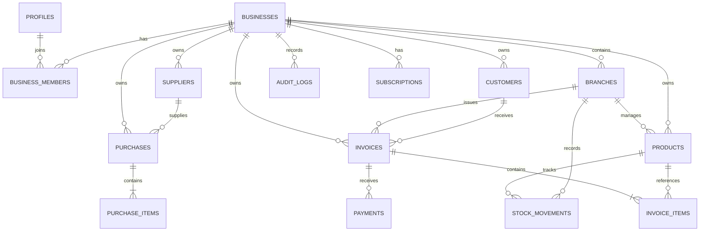

# DatabaseSchema

## Billing & Inventory SaaS — Database Schema Specification

**Version:** 1.0
**Status:** Draft for implementation
**Database:** PostgreSQL
**Backend:** Supabase
**Platforms:** Web SaaS + Android
**Primary currency:** INR (₹)
**Primary market:** India

---

# 1. Database Design Principles

The database must prioritize financial correctness, data isolation, inventory accuracy, and future scalability.

## 1.1 Core Principles

1. Every business-owned record must belong to a business.
2. All business data access must be authorized through Supabase Row Level Security (RLS) and trusted server-side operations.
3. A user may belong to multiple businesses.
4. Businesses may contain multiple branches.
5. All financial amounts must use `NUMERIC`, never floating-point types.
6. Finalized invoices must preserve their original financial values and history.
7. Inventory changes must be recorded in a stock movement ledger.
8. Invoice finalization, stock deduction, and related records must be transactionally consistent.
9. Payment history must be auditable and reconcilable.
10. Database constraints must enforce critical invariants wherever possible.
11. Store timestamps in `TIMESTAMPTZ`.
12. Use UUID primary keys for application entities.
13. Use migrations to manage schema changes.
14. Never expose service-role credentials to the browser or mobile app.
15. Do not rely exclusively on frontend validation for data integrity.

## 1.2 Naming Conventions

- Tables: `snake_case`, plural.
- Columns: `snake_case`.
- Primary keys: `id`.
- Foreign keys: descriptive names ending in `_id`.
- Timestamps: `created_at`, `updated_at`.
- Business ownership: `business_id`.
- Branch ownership: `branch_id`, where relevant.
- Monetary values: `NUMERIC(19,4)` for flexible calculations and stored rates where appropriate; use a documented rounding policy for final currency amounts.
- Quantities: `NUMERIC(19,4)` to support fractional units.

---

# 2. Entity Relationship Overview



This is a logical overview. The detailed schema below defines additional relationships and constraints.

---

# 3. Database Extensions and Shared Functions

Enable UUID generation:

```sql
CREATE EXTENSION IF NOT EXISTS pgcrypto;
```

## 3.1 Updated Timestamp Function

```sql
CREATE OR REPLACE FUNCTION public.set_updated_at()
RETURNS TRIGGER
LANGUAGE plpgsql
AS $$
BEGIN
    NEW.updated_at = NOW();
    RETURN NEW;
END;
$$;
```

Attach this trigger to tables that contain `updated_at`.

Do not use this trigger to alter immutable finalized invoice records.

---

# 4. Authentication and User Profiles

Supabase Auth owns credentials, sessions, password recovery, and authentication identity.

The application must not store plaintext passwords.

## 4.1 `profiles`

Stores application-specific information for authenticated users.

| Column                 | Type        | Rules                                    |
| ---------------------- | ----------- | ---------------------------------------- |
| `id`                 | UUID        | Primary key; references`auth.users.id` |
| `full_name`          | TEXT        | Nullable                                 |
| `phone`              | TEXT        | Nullable                                 |
| `avatar_url`         | TEXT        | Nullable                                 |
| `preferred_language` | TEXT        | Default`en`                            |
| `created_at`         | TIMESTAMPTZ | Default`NOW()`                         |
| `updated_at`         | TIMESTAMPTZ | Default`NOW()`                         |

```sql
CREATE TABLE public.profiles (
    id UUID PRIMARY KEY REFERENCES auth.users(id) ON DELETE CASCADE,
    full_name TEXT,
    phone TEXT,
    avatar_url TEXT,
    preferred_language TEXT NOT NULL DEFAULT 'en',
    created_at TIMESTAMPTZ NOT NULL DEFAULT NOW(),
    updated_at TIMESTAMPTZ NOT NULL DEFAULT NOW()
);
```

Create profile rows through a trusted signup workflow or carefully secured trigger.

---

# 5. Business and Membership Tables

## 5.1 `businesses`

Represents a company, shop, or other business account.

| Column                      | Type        | Rules                     |
| --------------------------- | ----------- | ------------------------- |
| `id`                      | UUID        | Primary key               |
| `name`                    | TEXT        | Required                  |
| `business_type`           | TEXT        | Nullable                  |
| `legal_name`              | TEXT        | Nullable                  |
| `phone`                   | TEXT        | Nullable                  |
| `email`                   | TEXT        | Nullable                  |
| `address_line_1`          | TEXT        | Nullable                  |
| `address_line_2`          | TEXT        | Nullable                  |
| `city`                    | TEXT        | Nullable                  |
| `state_code`              | TEXT        | Nullable                  |
| `postal_code`             | TEXT        | Nullable                  |
| `country_code`            | TEXT        | Default`IN`             |
| `currency_code`           | TEXT        | Default`INR`            |
| `timezone`                | TEXT        | Default`Asia/Kolkata`   |
| `gst_registration_status` | TEXT        | Required                  |
| `gstin`                   | TEXT        | Nullable                  |
| `logo_url`                | TEXT        | Nullable                  |
| `created_by`              | UUID        | References`profiles.id` |
| `created_at`              | TIMESTAMPTZ | Required                  |
| `updated_at`              | TIMESTAMPTZ | Required                  |
| `archived_at`             | TIMESTAMPTZ | Nullable                  |

```sql
CREATE TABLE public.businesses (
    id UUID PRIMARY KEY DEFAULT gen_random_uuid(),
    name TEXT NOT NULL,
    business_type TEXT,
    legal_name TEXT,
    phone TEXT,
    email TEXT,
    address_line_1 TEXT,
    address_line_2 TEXT,
    city TEXT,
    state_code TEXT,
    postal_code TEXT,
    country_code CHAR(2) NOT NULL DEFAULT 'IN',
    currency_code CHAR(3) NOT NULL DEFAULT 'INR',
    timezone TEXT NOT NULL DEFAULT 'Asia/Kolkata',
    gst_registration_status TEXT NOT NULL DEFAULT 'unregistered'
        CHECK (
            gst_registration_status IN (
                'registered',
                'unregistered',
                'composition',
                'other'
            )
        ),
    gstin TEXT,
    logo_url TEXT,
    created_by UUID REFERENCES public.profiles(id) ON DELETE SET NULL,
    created_at TIMESTAMPTZ NOT NULL DEFAULT NOW(),
    updated_at TIMESTAMPTZ NOT NULL DEFAULT NOW(),
    archived_at TIMESTAMPTZ
);
```

**Important:** A GSTIN format check does not prove that a GSTIN is valid or active. Use appropriate verification procedures before treating it as verified.

## 5.2 `business_members`

Defines which users can access which businesses.

| Column          | Type        | Rules                                           |
| --------------- | ----------- | ----------------------------------------------- |
| `id`          | UUID        | Primary key                                     |
| `business_id` | UUID        | References`businesses.id`                     |
| `user_id`     | UUID        | References`profiles.id`                       |
| `role`        | TEXT        | Owner, admin, manager, cashier, inventory staff |
| `status`      | TEXT        | Invited, active, suspended, removed             |
| `invited_by`  | UUID        | Nullable                                        |
| `joined_at`   | TIMESTAMPTZ | Nullable                                        |
| `created_at`  | TIMESTAMPTZ | Required                                        |

```sql
CREATE TABLE public.business_members (
    id UUID PRIMARY KEY DEFAULT gen_random_uuid(),
    business_id UUID NOT NULL REFERENCES public.businesses(id) ON DELETE RESTRICT,
    user_id UUID NOT NULL REFERENCES public.profiles(id) ON DELETE RESTRICT,
    role TEXT NOT NULL CHECK (
        role IN ('owner', 'admin', 'manager', 'cashier', 'inventory_staff')
    ),
    status TEXT NOT NULL DEFAULT 'active' CHECK (
        status IN ('invited', 'active', 'suspended', 'removed')
    ),
    invited_by UUID REFERENCES public.profiles(id) ON DELETE SET NULL,
    joined_at TIMESTAMPTZ,
    created_at TIMESTAMPTZ NOT NULL DEFAULT NOW(),
    UNIQUE (business_id, user_id)
);

CREATE INDEX idx_business_members_user_status
ON public.business_members(user_id, status);
```

A membership must be active before it grants access. Only trusted, authorized operations may assign the owner role.

---

# 6. Branches

## 6.1 `branches`

A business can operate one or more locations.

```sql
CREATE TABLE public.branches (
    id UUID PRIMARY KEY DEFAULT gen_random_uuid(),
    business_id UUID NOT NULL REFERENCES public.businesses(id) ON DELETE RESTRICT,
    name TEXT NOT NULL,
    code TEXT,
    phone TEXT,
    address_line_1 TEXT,
    address_line_2 TEXT,
    city TEXT,
    state_code TEXT,
    postal_code TEXT,
    is_default BOOLEAN NOT NULL DEFAULT FALSE,
    is_active BOOLEAN NOT NULL DEFAULT TRUE,
    created_at TIMESTAMPTZ NOT NULL DEFAULT NOW(),
    updated_at TIMESTAMPTZ NOT NULL DEFAULT NOW(),
    UNIQUE (business_id, id),
    UNIQUE (business_id, code)
);

CREATE UNIQUE INDEX idx_branches_one_default
ON public.branches(business_id)
WHERE is_default = TRUE;
```

Use `UNIQUE (business_id, code)` to prevent duplicate non-null branch codes within a business.

## 6.2 `branch_members`

Restricts a member to selected branches when branch-level access is enabled.

```sql
CREATE TABLE public.branch_members (
    id UUID PRIMARY KEY DEFAULT gen_random_uuid(),
    business_id UUID NOT NULL,
    branch_id UUID NOT NULL,
    user_id UUID NOT NULL,
    created_at TIMESTAMPTZ NOT NULL DEFAULT NOW(),

    FOREIGN KEY (business_id, branch_id)
        REFERENCES public.branches(business_id, id)
        ON DELETE RESTRICT,

    FOREIGN KEY (business_id, user_id)
        REFERENCES public.business_members(business_id, user_id)
        ON DELETE RESTRICT,

    UNIQUE (branch_id, user_id)
);
```

Define and enforce whether an empty branch-membership list means unrestricted access or no branch access. Do not leave this ambiguous in authorization code.

---

# 7. Product Catalogue

## 7.1 `categories`

```sql
CREATE TABLE public.categories (
    id UUID PRIMARY KEY DEFAULT gen_random_uuid(),
    business_id UUID NOT NULL REFERENCES public.businesses(id) ON DELETE RESTRICT,
    name TEXT NOT NULL,
    description TEXT,
    parent_id UUID,
    created_at TIMESTAMPTZ NOT NULL DEFAULT NOW(),
    updated_at TIMESTAMPTZ NOT NULL DEFAULT NOW(),

    UNIQUE (business_id, id),
    UNIQUE (business_id, name),

    FOREIGN KEY (business_id, parent_id)
        REFERENCES public.categories(business_id, id)
        ON DELETE RESTRICT
);
```

## 7.2 `products`

Product identity is business-wide. Inventory quantity is branch-specific and is not stored as an independently editable product field.

```sql
CREATE TABLE public.products (
    id UUID PRIMARY KEY DEFAULT gen_random_uuid(),
    business_id UUID NOT NULL REFERENCES public.businesses(id) ON DELETE RESTRICT,
    category_id UUID,
    name TEXT NOT NULL,
    description TEXT,
    sku TEXT,
    barcode TEXT,
    unit_code TEXT NOT NULL DEFAULT 'pcs',
    product_type TEXT NOT NULL DEFAULT 'goods'
        CHECK (product_type IN ('goods', 'service')),
    selling_price NUMERIC(19,4) NOT NULL DEFAULT 0
        CHECK (selling_price >= 0),
    purchase_cost NUMERIC(19,4)
        CHECK (purchase_cost IS NULL OR purchase_cost >= 0),
    tax_code TEXT,
    default_tax_rate NUMERIC(7,4) NOT NULL DEFAULT 0
        CHECK (default_tax_rate >= 0 AND default_tax_rate <= 100),
    track_inventory BOOLEAN NOT NULL DEFAULT TRUE,
    low_stock_threshold NUMERIC(19,4)
        CHECK (low_stock_threshold IS NULL OR low_stock_threshold >= 0),
    is_active BOOLEAN NOT NULL DEFAULT TRUE,
    created_at TIMESTAMPTZ NOT NULL DEFAULT NOW(),
    updated_at TIMESTAMPTZ NOT NULL DEFAULT NOW(),
    archived_at TIMESTAMPTZ,

    UNIQUE (business_id, id),

    FOREIGN KEY (business_id, category_id)
        REFERENCES public.categories(business_id, id)
        ON DELETE RESTRICT,

    CHECK (product_type <> 'service' OR track_inventory = FALSE)
);

CREATE UNIQUE INDEX idx_products_business_sku
ON public.products(business_id, sku)
WHERE sku IS NOT NULL;

CREATE UNIQUE INDEX idx_products_business_barcode
ON public.products(business_id, barcode)
WHERE barcode IS NOT NULL;

CREATE INDEX idx_products_business_name
ON public.products(business_id, name);
```

Do not hard-delete products referenced by finalized invoices or stock movements. Archive them instead.

Tax rates and `tax_code` are defaults, not proof that a tax treatment is legally applicable to every transaction.

---

# 8. Branch Inventory

## 8.1 `inventory_balances`

Stores the current stock balance for each tracked product at each branch.

```sql
CREATE TABLE public.inventory_balances (
    id UUID PRIMARY KEY DEFAULT gen_random_uuid(),
    business_id UUID NOT NULL,
    branch_id UUID NOT NULL,
    product_id UUID NOT NULL,
    quantity_on_hand NUMERIC(19,4) NOT NULL DEFAULT 0,
    updated_at TIMESTAMPTZ NOT NULL DEFAULT NOW(),

    UNIQUE (business_id, branch_id, product_id),

    FOREIGN KEY (business_id, branch_id)
        REFERENCES public.branches(business_id, id)
        ON DELETE RESTRICT,

    FOREIGN KEY (business_id, product_id)
        REFERENCES public.products(business_id, id)
        ON DELETE RESTRICT
);
```

This is a maintained balance, not the sole inventory source of truth. It must reconcile with the stock movement ledger.

## 8.2 `stock_movements`

Records all stock increases and decreases.

```sql
CREATE TABLE public.stock_movements (
    id UUID PRIMARY KEY DEFAULT gen_random_uuid(),
    business_id UUID NOT NULL,
    branch_id UUID NOT NULL,
    product_id UUID NOT NULL,
    movement_type TEXT NOT NULL CHECK (
        movement_type IN (
            'opening_stock',
            'sale',
            'sale_return',
            'purchase_receipt',
            'purchase_return',
            'adjustment_in',
            'adjustment_out',
            'transfer_in',
            'transfer_out',
            'reversal'
        )
    ),
    quantity_delta NUMERIC(19,4) NOT NULL CHECK (quantity_delta <> 0),
    unit_cost NUMERIC(19,4)
        CHECK (unit_cost IS NULL OR unit_cost >= 0),
    reference_type TEXT,
    reference_id UUID,
    idempotency_key TEXT,
    reason TEXT,
    notes TEXT,
    created_by UUID REFERENCES public.profiles(id) ON DELETE SET NULL,
    created_at TIMESTAMPTZ NOT NULL DEFAULT NOW(),

    FOREIGN KEY (business_id, branch_id)
        REFERENCES public.branches(business_id, id)
        ON DELETE RESTRICT,

    FOREIGN KEY (business_id, product_id)
        REFERENCES public.products(business_id, id)
        ON DELETE RESTRICT,

    UNIQUE (business_id, id),

    CHECK (
        (movement_type IN (
            'opening_stock',
            'purchase_receipt',
            'adjustment_in',
            'transfer_in',
            'sale_return'
        ) AND quantity_delta > 0)
        OR
        (movement_type IN (
            'sale',
            'purchase_return',
            'adjustment_out',
            'transfer_out'
        ) AND quantity_delta < 0)
        OR movement_type = 'reversal'
    )
);

CREATE UNIQUE INDEX idx_stock_movement_idempotency
ON public.stock_movements(business_id, idempotency_key)
WHERE idempotency_key IS NOT NULL;

CREATE INDEX idx_stock_movements_product_time
ON public.stock_movements(
    business_id,
    branch_id,
    product_id,
    created_at DESC
);
```

### Stock integrity requirements

- Inventory movements must be inserted through trusted transaction functions.
- Do not allow ordinary users to edit or delete ledger entries.
- Corrections must create compensating movements.
- Update `inventory_balances` in the same database transaction as the movement.
- Lock the relevant balance row when concurrent stock changes could conflict.
- Enforce the configured negative-stock policy inside the transaction.
- Validate that products with `track_inventory = FALSE` do not create ordinary stock movements.
- Validate movement signs against their movement type.
- Validate the source transaction for sale, purchase, return, and transfer movements.
- Ensure transfer-out and transfer-in movements correspond to the same transfer.

The sample schema defines a ledger structure; transaction functions and permissions are still required to enforce all these rules.

---

# 9. Customers

## 9.1 `customers`

```sql
CREATE TABLE public.customers (
    id UUID PRIMARY KEY DEFAULT gen_random_uuid(),
    business_id UUID NOT NULL REFERENCES public.businesses(id) ON DELETE RESTRICT,
    name TEXT NOT NULL,
    phone TEXT,
    email TEXT,
    gstin TEXT,
    billing_address JSONB NOT NULL DEFAULT '{}'::JSONB,
    shipping_address JSONB NOT NULL DEFAULT '{}'::JSONB,
    notes TEXT,
    opening_balance NUMERIC(19,4) NOT NULL DEFAULT 0,
    is_active BOOLEAN NOT NULL DEFAULT TRUE,
    created_at TIMESTAMPTZ NOT NULL DEFAULT NOW(),
    updated_at TIMESTAMPTZ NOT NULL DEFAULT NOW(),
    archived_at TIMESTAMPTZ,

    UNIQUE (business_id, id)
);

CREATE INDEX idx_customers_business_name
ON public.customers(business_id, name);

CREATE INDEX idx_customers_business_phone
ON public.customers(business_id, phone);
```

Opening balances must be migrated or recorded with a clear accounting meaning. Do not silently treat an opening balance as a new invoice or payment.

---

# 10. Suppliers

## 10.1 `suppliers`

```sql
CREATE TABLE public.suppliers (
    id UUID PRIMARY KEY DEFAULT gen_random_uuid(),
    business_id UUID NOT NULL REFERENCES public.businesses(id) ON DELETE RESTRICT,
    name TEXT NOT NULL,
    phone TEXT,
    email TEXT,
    gstin TEXT,
    address JSONB NOT NULL DEFAULT '{}'::JSONB,
    notes TEXT,
    opening_balance NUMERIC(19,4) NOT NULL DEFAULT 0,
    is_active BOOLEAN NOT NULL DEFAULT TRUE,
    created_at TIMESTAMPTZ NOT NULL DEFAULT NOW(),
    updated_at TIMESTAMPTZ NOT NULL DEFAULT NOW(),
    archived_at TIMESTAMPTZ,

    UNIQUE (business_id, id)
);

CREATE INDEX idx_suppliers_business_name
ON public.suppliers(business_id, name);
```

Supplier balances must be derived from or reconciled with purchase and supplier-payment records.

---

# 11. Invoices

## 11.1 `invoices`

Stores sales invoice headers.

```sql
CREATE TABLE public.invoices (
    id UUID PRIMARY KEY DEFAULT gen_random_uuid(),
    business_id UUID NOT NULL,
    branch_id UUID NOT NULL,
    customer_id UUID,
    invoice_number TEXT,
    invoice_sequence BIGINT,
    status TEXT NOT NULL DEFAULT 'draft'
        CHECK (status IN ('draft', 'finalized', 'cancelled')),
    issue_date DATE,
    due_date DATE,
    currency_code CHAR(3) NOT NULL DEFAULT 'INR',
    subtotal NUMERIC(19,4) NOT NULL DEFAULT 0,
    discount_amount NUMERIC(19,4) NOT NULL DEFAULT 0,
    taxable_amount NUMERIC(19,4) NOT NULL DEFAULT 0,
    tax_amount NUMERIC(19,4) NOT NULL DEFAULT 0,
    round_off_amount NUMERIC(19,4) NOT NULL DEFAULT 0,
    total_amount NUMERIC(19,4) NOT NULL DEFAULT 0,
    amount_paid NUMERIC(19,4) NOT NULL DEFAULT 0,
    notes TEXT,
    terms TEXT,
    customer_snapshot JSONB NOT NULL DEFAULT '{}'::JSONB,
    business_snapshot JSONB NOT NULL DEFAULT '{}'::JSONB,
    tax_summary JSONB NOT NULL DEFAULT '[]'::JSONB,
    created_by UUID REFERENCES public.profiles(id) ON DELETE SET NULL,
    finalized_by UUID REFERENCES public.profiles(id) ON DELETE SET NULL,
    finalized_at TIMESTAMPTZ,
    created_at TIMESTAMPTZ NOT NULL DEFAULT NOW(),
    updated_at TIMESTAMPTZ NOT NULL DEFAULT NOW(),

    UNIQUE (business_id, id),

    FOREIGN KEY (business_id, branch_id)
        REFERENCES public.branches(business_id, id)
        ON DELETE RESTRICT,

    FOREIGN KEY (business_id, customer_id)
        REFERENCES public.customers(business_id, id)
        ON DELETE RESTRICT,

    CHECK (subtotal >= 0),
    CHECK (discount_amount >= 0),
    CHECK (taxable_amount >= 0),
    CHECK (tax_amount >= 0),
    CHECK (total_amount >= 0),
    CHECK (amount_paid >= 0),
    CHECK (
        (status = 'draft'
            AND invoice_number IS NULL
            AND finalized_at IS NULL)
        OR
        (status IN ('finalized', 'cancelled')
            AND invoice_number IS NOT NULL
            AND finalized_at IS NOT NULL)
    )
);

CREATE UNIQUE INDEX idx_invoices_business_number
ON public.invoices(business_id, invoice_number)
WHERE invoice_number IS NOT NULL;

CREATE INDEX idx_invoices_business_date
ON public.invoices(business_id, issue_date DESC);

CREATE INDEX idx_invoices_business_status
ON public.invoices(business_id, status);

CREATE INDEX idx_invoices_customer
ON public.invoices(business_id, customer_id, issue_date DESC);
```

**Implementation notes:**

- Draft invoices do not receive their authoritative invoice number until finalization.
- Invoice numbering must be allocated using a locked sequence/counter in the finalization transaction.
- The invoice must retain snapshots of the business and customer details needed to reproduce the issued document.
- Tax calculation and rounding rules must be implemented centrally and tested.
- Financial fields on finalized invoices must be immutable through ordinary update operations.
- `amount_paid` is a cached value if retained; it must be updated transactionally or reconciled with payment allocations.
- A cancellation must follow the approved financial and tax workflow; it must not simply erase the original invoice.

---

# 12. Invoice Items

## 12.1 `invoice_items`

Each row represents a product or service on an invoice.

```sql
CREATE TABLE public.invoice_items (
    id UUID PRIMARY KEY DEFAULT gen_random_uuid(),
    business_id UUID NOT NULL,
    invoice_id UUID NOT NULL,
    product_id UUID,
    description TEXT NOT NULL,
    sku_snapshot TEXT,
    unit_code TEXT NOT NULL DEFAULT 'pcs',
    quantity NUMERIC(19,4) NOT NULL CHECK (quantity > 0),
    unit_price NUMERIC(19,4) NOT NULL CHECK (unit_price >= 0),
    discount_amount NUMERIC(19,4) NOT NULL DEFAULT 0
        CHECK (discount_amount >= 0),
    taxable_amount NUMERIC(19,4) NOT NULL DEFAULT 0
        CHECK (taxable_amount >= 0),
    tax_rate NUMERIC(7,4) NOT NULL DEFAULT 0
        CHECK (tax_rate >= 0 AND tax_rate <= 100),
    tax_amount NUMERIC(19,4) NOT NULL DEFAULT 0
        CHECK (tax_amount >= 0),
    line_total NUMERIC(19,4) NOT NULL DEFAULT 0
        CHECK (line_total >= 0),
    tax_details JSONB NOT NULL DEFAULT '[]'::JSONB,
    created_at TIMESTAMPTZ NOT NULL DEFAULT NOW(),

    FOREIGN KEY (business_id, invoice_id)
        REFERENCES public.invoices(business_id, id)
        ON DELETE RESTRICT,

    FOREIGN KEY (business_id, product_id)
        REFERENCES public.products(business_id, id)
        ON DELETE RESTRICT
);

CREATE INDEX idx_invoice_items_invoice
ON public.invoice_items(business_id, invoice_id);

CREATE INDEX idx_invoice_items_product
ON public.invoice_items(business_id, product_id);
```

### Invoice item rules

- A finalized invoice's item rows must be immutable.
- Product name, SKU, unit, price, discount, and tax details needed for the issued document must be snapshotted.
- The database must validate that item rows cannot be modified after their invoice is finalized.
- Invoice totals must be calculated from the validated line items using the agreed rounding policy.
- If invoice-level discounts are supported, define and test how they are allocated to taxable line items.
- `tax_details` should preserve the applicable breakdown, such as CGST, SGST, or IGST, as relevant to the transaction.

---

# 13. Invoice Numbering

## 13.1 `invoice_counters`

```sql
CREATE TABLE public.invoice_counters (
    id UUID PRIMARY KEY DEFAULT gen_random_uuid(),
    business_id UUID NOT NULL,
    branch_id UUID NOT NULL,
    financial_year TEXT NOT NULL,
    prefix TEXT NOT NULL DEFAULT 'INV',
    next_number BIGINT NOT NULL DEFAULT 1 CHECK (next_number > 0),
    updated_at TIMESTAMPTZ NOT NULL DEFAULT NOW(),

    FOREIGN KEY (business_id, branch_id)
        REFERENCES public.branches(business_id, id)
        ON DELETE RESTRICT,

    UNIQUE (business_id, branch_id, financial_year, prefix)
);
```

### Number allocation requirements

The finalization procedure must:

1. Lock the relevant counter row.
2. Read and reserve the next number.
3. Build the invoice number according to the configured format.
4. Finalize the invoice.
5. Commit the counter and invoice together.
6. Roll back the entire operation if any required step fails.

Define the applicable numbering scope, financial-year rules, and legal requirements before production use. A PostgreSQL sequence alone does not guarantee gapless numbering.

---

# 14. Payments and Payment Allocations

Use separate payment and allocation records so a payment can be reconciled against one or more invoices if the product supports that workflow.

## 14.1 `payments`

```sql
CREATE TABLE public.payments (
    id UUID PRIMARY KEY DEFAULT gen_random_uuid(),
    business_id UUID NOT NULL,
    branch_id UUID NOT NULL,
    customer_id UUID,
    payment_number TEXT,
    payment_direction TEXT NOT NULL DEFAULT 'in'
        CHECK (payment_direction IN ('in', 'out')),
    payment_method TEXT NOT NULL
        CHECK (
            payment_method IN (
                'cash',
                'upi',
                'bank_transfer',
                'card',
                'cheque',
                'other'
            )
        ),
    amount NUMERIC(19,4) NOT NULL CHECK (amount > 0),
    currency_code CHAR(3) NOT NULL DEFAULT 'INR',
    payment_date DATE NOT NULL DEFAULT CURRENT_DATE,
    reference_number TEXT,
    status TEXT NOT NULL DEFAULT 'recorded'
        CHECK (status IN ('recorded', 'reversed')),
    notes TEXT,
    idempotency_key TEXT,
    created_by UUID REFERENCES public.profiles(id) ON DELETE SET NULL,
    created_at TIMESTAMPTZ NOT NULL DEFAULT NOW(),

    FOREIGN KEY (business_id, branch_id)
        REFERENCES public.branches(business_id, id)
        ON DELETE RESTRICT,

    FOREIGN KEY (business_id, customer_id)
        REFERENCES public.customers(business_id, id)
        ON DELETE RESTRICT,

    UNIQUE (business_id, id)
);

CREATE UNIQUE INDEX idx_payments_idempotency
ON public.payments(business_id, idempotency_key)
WHERE idempotency_key IS NOT NULL;

CREATE INDEX idx_payments_customer_date
ON public.payments(business_id, customer_id, payment_date DESC);
```

## 14.2 `payment_allocations`

```sql
CREATE TABLE public.payment_allocations (
    id UUID PRIMARY KEY DEFAULT gen_random_uuid(),
    business_id UUID NOT NULL,
    payment_id UUID NOT NULL,
    invoice_id UUID NOT NULL,
    allocated_amount NUMERIC(19,4) NOT NULL
        CHECK (allocated_amount > 0),
    created_at TIMESTAMPTZ NOT NULL DEFAULT NOW(),

    FOREIGN KEY (business_id, payment_id)
        REFERENCES public.payments(business_id, id)
        ON DELETE RESTRICT,

    FOREIGN KEY (business_id, invoice_id)
        REFERENCES public.invoices(business_id, id)
        ON DELETE RESTRICT,

    UNIQUE (payment_id, invoice_id)
);

CREATE INDEX idx_payment_allocations_invoice
ON public.payment_allocations(business_id, invoice_id);
```

### Payment integrity rules

The trusted payment-recording transaction must validate that:

- Payment and invoice belong to the same business.
- Payment direction matches the transaction.
- The allocated amount does not exceed the remaining allocatable amount.
- The sum of allocations does not exceed the payment amount.
- Reversed payments are excluded from active balances.
- Invoice balances are recalculated or updated transactionally.
- Duplicate retries cannot record the same payment twice.

The basic schema does not itself enforce aggregate allocation limits. Use a trusted database function with suitable row locking or another proven concurrency-safe mechanism.

Unallocated payments and customer advances must have an explicit business policy.

---

# 15. Purchases and Purchase Items

These tables support supplier purchases and stock receipts. They can be introduced after the core MVP if needed.

## 15.1 `purchases`

```sql
CREATE TABLE public.purchases (
    id UUID PRIMARY KEY DEFAULT gen_random_uuid(),
    business_id UUID NOT NULL,
    branch_id UUID NOT NULL,
    supplier_id UUID NOT NULL,
    purchase_number TEXT,
    supplier_invoice_number TEXT,
    status TEXT NOT NULL DEFAULT 'draft'
        CHECK (
            status IN (
                'draft',
                'ordered',
                'partially_received',
                'received',
                'cancelled'
            )
        ),
    purchase_date DATE,
    subtotal NUMERIC(19,4) NOT NULL DEFAULT 0,
    discount_amount NUMERIC(19,4) NOT NULL DEFAULT 0,
    tax_amount NUMERIC(19,4) NOT NULL DEFAULT 0,
    total_amount NUMERIC(19,4) NOT NULL DEFAULT 0,
    notes TEXT,
    created_by UUID REFERENCES public.profiles(id) ON DELETE SET NULL,
    created_at TIMESTAMPTZ NOT NULL DEFAULT NOW(),
    updated_at TIMESTAMPTZ NOT NULL DEFAULT NOW(),

    UNIQUE (business_id, id),

    FOREIGN KEY (business_id, branch_id)
        REFERENCES public.branches(business_id, id)
        ON DELETE RESTRICT,

    FOREIGN KEY (business_id, supplier_id)
        REFERENCES public.suppliers(business_id, id)
        ON DELETE RESTRICT
);
```

## 15.2 `purchase_items`

```sql
CREATE TABLE public.purchase_items (
    id UUID PRIMARY KEY DEFAULT gen_random_uuid(),
    business_id UUID NOT NULL,
    purchase_id UUID NOT NULL,
    product_id UUID NOT NULL,
    quantity_ordered NUMERIC(19,4) NOT NULL CHECK (quantity_ordered > 0),
    quantity_received NUMERIC(19,4) NOT NULL DEFAULT 0
        CHECK (quantity_received >= 0),
    unit_cost NUMERIC(19,4) NOT NULL CHECK (unit_cost >= 0),
    tax_rate NUMERIC(7,4) NOT NULL DEFAULT 0
        CHECK (tax_rate >= 0 AND tax_rate <= 100),
    line_total NUMERIC(19,4) NOT NULL DEFAULT 0,
    created_at TIMESTAMPTZ NOT NULL DEFAULT NOW(),

    FOREIGN KEY (business_id, purchase_id)
        REFERENCES public.purchases(business_id, id)
        ON DELETE RESTRICT,

    FOREIGN KEY (business_id, product_id)
        REFERENCES public.products(business_id, id)
        ON DELETE RESTRICT,

    CHECK (quantity_received <= quantity_ordered)
);
```

A goods-receipt workflow should create stock movements transactionally and prevent the same received quantity from being posted twice.

Supplier payment and purchase-return workflows require their own audited records before production.

---

# 16. Audit Logs

## 16.1 `audit_logs`

Records security-sensitive and financially important events.

```sql
CREATE TABLE public.audit_logs (
    id UUID PRIMARY KEY DEFAULT gen_random_uuid(),
    business_id UUID NOT NULL REFERENCES public.businesses(id) ON DELETE RESTRICT,
    actor_user_id UUID REFERENCES public.profiles(id) ON DELETE SET NULL,
    action TEXT NOT NULL,
    entity_type TEXT NOT NULL,
    entity_id UUID,
    metadata JSONB NOT NULL DEFAULT '{}'::JSONB,
    request_id TEXT,
    ip_address INET,
    created_at TIMESTAMPTZ NOT NULL DEFAULT NOW()
);

CREATE INDEX idx_audit_logs_business_time
ON public.audit_logs(business_id, created_at DESC);

CREATE INDEX idx_audit_logs_entity
ON public.audit_logs(business_id, entity_type, entity_id);
```

### Audit requirements

Record events such as:

- Invoice finalized or cancelled
- Payment recorded or reversed
- Stock adjusted
- Staff role changed
- Branch access changed
- GST configuration changed
- Subscription entitlements changed

Audit logs should be append-only for normal application roles. Avoid storing passwords, access tokens, full payment credentials, or unnecessary personal data in metadata.

For stronger tamper resistance, restrict direct table access and write logs through trusted server-side functions.

---

# 17. Subscriptions and Plans

## 17.1 `subscription_plans`

```sql
CREATE TABLE public.subscription_plans (
    id UUID PRIMARY KEY DEFAULT gen_random_uuid(),
    code TEXT NOT NULL UNIQUE,
    name TEXT NOT NULL,
    description TEXT,
    price_monthly NUMERIC(19,4) NOT NULL DEFAULT 0
        CHECK (price_monthly >= 0),
    price_yearly NUMERIC(19,4) NOT NULL DEFAULT 0
        CHECK (price_yearly >= 0),
    currency_code CHAR(3) NOT NULL DEFAULT 'INR',
    limits JSONB NOT NULL DEFAULT '{}'::JSONB,
    features JSONB NOT NULL DEFAULT '{}'::JSONB,
    is_active BOOLEAN NOT NULL DEFAULT TRUE,
    created_at TIMESTAMPTZ NOT NULL DEFAULT NOW(),
    updated_at TIMESTAMPTZ NOT NULL DEFAULT NOW()
);
```

## 17.2 `subscriptions`

```sql
CREATE TABLE public.subscriptions (
    id UUID PRIMARY KEY DEFAULT gen_random_uuid(),
    business_id UUID NOT NULL REFERENCES public.businesses(id) ON DELETE RESTRICT,
    plan_id UUID NOT NULL REFERENCES public.subscription_plans(id) ON DELETE RESTRICT,
    status TEXT NOT NULL DEFAULT 'trial'
        CHECK (
            status IN (
                'trial',
                'active',
                'past_due',
                'cancelled',
                'expired'
            )
        ),
    billing_interval TEXT NOT NULL DEFAULT 'monthly'
        CHECK (billing_interval IN ('monthly', 'yearly')),
    trial_starts_at TIMESTAMPTZ,
    trial_ends_at TIMESTAMPTZ,
    current_period_starts_at TIMESTAMPTZ,
    current_period_ends_at TIMESTAMPTZ,
    cancelled_at TIMESTAMPTZ,
    provider TEXT,
    provider_customer_id TEXT,
    provider_subscription_id TEXT,
    created_at TIMESTAMPTZ NOT NULL DEFAULT NOW(),
    updated_at TIMESTAMPTZ NOT NULL DEFAULT NOW()
);

CREATE UNIQUE INDEX idx_subscriptions_provider_id
ON public.subscriptions(provider, provider_subscription_id)
WHERE provider_subscription_id IS NOT NULL;

CREATE INDEX idx_subscriptions_business_status
ON public.subscriptions(business_id, status);
```

Enforce the policy for a business's current subscription in a trusted transaction. Do not assume the newest subscription row is necessarily the active entitlement.

Plan limits must be enforced by backend logic. Changes to plan definitions must not accidentally grant or remove entitlements without an explicit migration or policy.

---

# 18. Import Jobs

## 18.1 `import_jobs`

Tracks CSV imports for products, customers, and other supported entities.

```sql
CREATE TABLE public.import_jobs (
    id UUID PRIMARY KEY DEFAULT gen_random_uuid(),
    business_id UUID NOT NULL REFERENCES public.businesses(id) ON DELETE RESTRICT,
    created_by UUID REFERENCES public.profiles(id) ON DELETE SET NULL,
    import_type TEXT NOT NULL
        CHECK (import_type IN ('products', 'customers', 'suppliers')),
    status TEXT NOT NULL DEFAULT 'pending'
        CHECK (
            status IN (
                'pending',
                'processing',
                'completed',
                'completed_with_errors',
                'failed'
            )
        ),
    total_rows INTEGER NOT NULL DEFAULT 0,
    processed_rows INTEGER NOT NULL DEFAULT 0,
    failed_rows INTEGER NOT NULL DEFAULT 0,
    error_report JSONB NOT NULL DEFAULT '[]'::JSONB,
    created_at TIMESTAMPTZ NOT NULL DEFAULT NOW(),
    completed_at TIMESTAMPTZ
);
```

Store uploaded files in private object storage. Validate file type, size, content, and user permissions before processing.

---

# 19. Optional Idempotency Records

For operations that need reliable retry protection, such as invoice finalization or stock transfers, an explicit idempotency table can help.

```sql
CREATE TABLE public.idempotency_records (
    id UUID PRIMARY KEY DEFAULT gen_random_uuid(),
    business_id UUID NOT NULL REFERENCES public.businesses(id) ON DELETE RESTRICT,
    idempotency_key TEXT NOT NULL,
    operation TEXT NOT NULL,
    request_hash TEXT NOT NULL,
    response_status INTEGER,
    response_body JSONB,
    resource_id UUID,
    created_at TIMESTAMPTZ NOT NULL DEFAULT NOW(),
    expires_at TIMESTAMPTZ,

    UNIQUE (business_id, operation, idempotency_key)
);
```

The idempotency implementation must:

- Bind a key to the intended operation and request payload.
- Reject reuse with a different request payload.
- Coordinate concurrent requests safely.
- Return the stored result for a valid retry.
- Commit the idempotency result with the underlying operation.
- Retain records for the required retry and audit window.

---

# 20. Row Level Security (RLS)

Enable RLS on every exposed table containing private user, business, financial, or operational data.

Example:

```sql
ALTER TABLE public.businesses ENABLE ROW LEVEL SECURITY;
ALTER TABLE public.business_members ENABLE ROW LEVEL SECURITY;
ALTER TABLE public.branches ENABLE ROW LEVEL SECURITY;
ALTER TABLE public.products ENABLE ROW LEVEL SECURITY;
ALTER TABLE public.inventory_balances ENABLE ROW LEVEL SECURITY;
ALTER TABLE public.stock_movements ENABLE ROW LEVEL SECURITY;
ALTER TABLE public.customers ENABLE ROW LEVEL SECURITY;
ALTER TABLE public.suppliers ENABLE ROW LEVEL SECURITY;
ALTER TABLE public.invoices ENABLE ROW LEVEL SECURITY;
ALTER TABLE public.invoice_items ENABLE ROW LEVEL SECURITY;
ALTER TABLE public.payments ENABLE ROW LEVEL SECURITY;
ALTER TABLE public.payment_allocations ENABLE ROW LEVEL SECURITY;
ALTER TABLE public.purchases ENABLE ROW LEVEL SECURITY;
ALTER TABLE public.purchase_items ENABLE ROW LEVEL SECURITY;
ALTER TABLE public.audit_logs ENABLE ROW LEVEL SECURITY;
ALTER TABLE public.subscriptions ENABLE ROW LEVEL SECURITY;
```

Enable RLS for the remaining exposed tables as well, including profiles, categories, branch memberships, invoice counters, subscription plans where appropriate, and import jobs.

## 20.1 Membership Helper Function

A security-definer helper can simplify membership checks when implemented carefully.

```sql
CREATE OR REPLACE FUNCTION public.is_active_business_member(
    p_business_id UUID
)
RETURNS BOOLEAN
LANGUAGE SQL
STABLE
SECURITY DEFINER
SET search_path = ''
AS $$
    SELECT EXISTS (
        SELECT 1
        FROM public.business_members AS bm
        WHERE bm.business_id = p_business_id
          AND bm.user_id = (SELECT auth.uid())
          AND bm.status = 'active'
    );
$$;
```

Restrict execution to intended roles:

```sql
REVOKE ALL ON FUNCTION public.is_active_business_member(UUID) FROM PUBLIC;
GRANT EXECUTE ON FUNCTION public.is_active_business_member(UUID)
TO authenticated;
```

Review the function owner, table permissions, and RLS interaction carefully before production use. Security-definer functions must not become a way to bypass tenant isolation.

## 20.2 Example Read Policy

```sql
CREATE POLICY "Active members can read products"
ON public.products
FOR SELECT
TO authenticated
USING (
    public.is_active_business_member(business_id)
);
```

This is an example of a business-level policy, not a complete production policy set.

## 20.3 Required Authorization Policies

Create and test appropriate policies for:

- Reading records in authorized businesses
- Creating records only for authorized businesses
- Updating records only with the required role and scope
- Archiving records according to business policy
- Restricting branch-level data
- Restricting financial and administrative operations
- Protecting profile information
- Limiting audit-log access
- Preventing users from assigning themselves privileged roles
- Restricting subscription changes and privileged transaction functions

For financial mutations, prefer narrow, audited database functions or trusted server-side endpoints over broad direct table-write permissions.

**Important:** RLS policies do not replace transaction-level business validation. A user who can update a row must still not be able to bypass invoice, payment, or stock invariants.

---

# 21. Cross-Business Integrity

Every relationship between two business-owned records must enforce business consistency.

For example, an invoice must not reference a customer from another business.

Use composite foreign keys such as:

```sql
FOREIGN KEY (business_id, customer_id)
REFERENCES public.customers(business_id, id)
```

The referenced table must have a matching unique constraint or primary key.

Apply this pattern to:

- Branches and businesses
- Products and categories
- Products and stock balances
- Products and stock movements
- Invoices and branches
- Invoices and customers
- Invoice items and invoices
- Invoice items and products
- Payments and customers
- Payment allocations and payments
- Payment allocations and invoices
- Purchases and suppliers
- Purchase items and purchases

Review all new tables for missing business-scoped foreign keys before merging migrations.

---

# 22. Data Integrity and Transaction Functions

The schema alone does not provide all the required accounting guarantees. Implement trusted PostgreSQL functions or server-side transaction workflows for critical operations.

## 22.1 `finalize_invoice()`

Responsibilities:

1. Authenticate the caller and validate business membership.
2. Check the user's role and branch access.
3. Lock the draft invoice and required inventory rows.
4. Validate invoice items and product eligibility.
5. Recalculate totals using trusted server-side logic.
6. Validate stock availability under the business's stock policy.
7. Allocate the next invoice number.
8. Save immutable invoice snapshots.
9. Insert stock movements.
10. Update inventory balances.
11. Mark the invoice finalized.
12. Write an audit event.
13. Commit all changes atomically.

If any required step fails, roll back the transaction.

## 22.2 `record_payment()`

Responsibilities:

1. Validate caller authorization.
2. Validate business, customer, and invoice relationships.
3. Check idempotency.
4. Validate payment amount and direction.
5. Insert the payment.
6. Allocate payment amounts.
7. Update or reconcile invoice balances.
8. Record the audit event.
9. Commit atomically.

## 22.3 `adjust_stock()`

Responsibilities:

1. Validate business and branch access.
2. Validate product and tracking settings.
3. Lock the relevant inventory balance.
4. Validate quantity and adjustment reason.
5. Enforce the negative-stock policy.
6. Insert a stock movement.
7. Update the current balance.
8. Record the audit event.
9. Commit atomically.

These functions must have explicit grants and must validate all caller-supplied IDs and amounts. Do not trust values just because they originated from the frontend.

---

# 23. Finalized Record Immutability

Use database permissions and triggers to prevent ordinary application roles from changing finalized invoice financial fields or invoice items.

Required protections:

- Prevent edits to finalized invoice amounts, tax details, invoice number, and issue date.
- Prevent inserts, updates, and deletes of finalized invoice items through ordinary application access.
- Preserve the original invoice after cancellation.
- Use controlled reversal or correction workflows.
- Preserve stock movement history.
- Reverse payments through traceable records.
- Audit privileged corrections.

Avoid implementing immutability as an unconditional trigger that prevents all trusted administrative migrations. Use a clear, narrowly scoped trusted workflow.

---

# 24. Financial and Tax Calculation Policy

## 24.1 Monetary Precision

- Use `NUMERIC` for monetary values and rates.
- Define a consistent currency precision and rounding strategy.
- Keep intermediate calculations precise enough for the selected tax and pricing rules.
- Round at documented calculation boundaries.
- Use the same calculation engine for web and Android by relying on authoritative server-side totals.

## 24.2 GST Considerations

The schema must support the tax treatment applicable to the transaction, which may include:

- CGST and SGST
- IGST
- Applicable cess or other tax components
- Exempt, nil-rated, or zero-rated treatment, where applicable
- HSN/SAC details, where required
- Place-of-supply information, where applicable
- Tax-inclusive or tax-exclusive prices, according to the selected policy

Do not assume a single tax rate or one fixed tax calculation applies to all products and invoices.

Before production launch, review the schema and invoice workflow against current GST requirements with a qualified Indian tax professional. E-invoicing, e-way bills, credit notes, debit notes, and other statutory requirements may require additional tables and integrations.

---

# 25. Indexing Strategy

Recommended indexes include:

| Table                   | Index purpose                                  |
| ----------------------- | ---------------------------------------------- |
| `business_members`    | Find a user's active businesses                |
| `branch_members`      | Check branch access                            |
| `products`            | Search products by name, SKU, and barcode      |
| `inventory_balances`  | Read branch stock quickly                      |
| `stock_movements`     | Inspect movement history                       |
| `customers`           | Search customers                               |
| `invoices`            | Filter by business, date, status, and customer |
| `invoice_items`       | Load invoice details                           |
| `payments`            | Find payment history                           |
| `payment_allocations` | Reconcile invoices and payments                |
| `purchases`           | Search purchase history                        |
| `audit_logs`          | Retrieve audit history by time                 |
| `subscriptions`       | Check business entitlements                    |

Add further indexes only when query patterns and execution plans justify them. Excessive indexes slow writes and increase storage usage.

---

# 26. Backup, Retention, and Recovery

Production requirements:

- Enable an appropriate database backup plan.
- Define recovery point and recovery time objectives.
- Test restoration procedures.
- Restrict database export privileges.
- Protect uploaded invoices and import files in private storage.
- Define retention policies for audit and financial records.
- Avoid hard deletion of records required for legal, financial, or audit purposes.
- Document data export and business account deletion workflows.
- Test disaster recovery before onboarding paying customers.

Backup availability depends on the selected hosting plan and configuration; verify actual retention and restore capabilities.

---

# 27. Recommended Migration Order

Create database migrations in this order:

1. Extensions and shared functions
2. User profiles
3. Businesses
4. Business memberships
5. Branches
6. Branch memberships
7. Categories
8. Products
9. Inventory balances
10. Stock movements
11. Customers
12. Suppliers
13. Invoices
14. Invoice items
15. Invoice counters
16. Payments
17. Payment allocations
18. Purchases
19. Purchase items
20. Audit logs
21. Subscription plans
22. Subscriptions
23. Import jobs
24. Idempotency records
25. Updated-at triggers
26. Constraints and indexes
27. RLS enablement and policies
28. Trusted transaction functions
29. Grants and permissions
30. Automated database tests

Each migration should be version-controlled, reviewable, and tested against a clean database.

---

# 28. Required Database Tests

Before production, test at least the following scenarios:

## Authentication and tenancy

- A user cannot access another business's products.
- A user cannot read another business's invoices.
- A user cannot insert records referencing another business's customer.
- Suspended and removed members lose access.
- Users cannot assign themselves owner permissions.
- Branch restrictions are enforced.

## Inventory

- Stock cannot go below zero when the policy forbids it.
- Concurrent sales cannot oversell the same stock.
- Retried stock adjustments cannot duplicate movements.
- Stock balances reconcile with ledger movements.
- A failed invoice finalization leaves stock unchanged.

## Invoicing

- Concurrent invoice finalizations receive unique numbers.
- Invalid totals are rejected or recalculated.
- Finalized invoice items cannot be modified through ordinary access.
- Failed finalization rolls back all related changes.
- Cancellation preserves the original invoice and audit trail.

## Payments

- Duplicate requests do not create duplicate payments.
- Payment allocations cannot exceed the permitted amounts.
- Reversed payments are excluded from active balances.
- Invoice outstanding balances reconcile with payment history.

## Subscriptions

- Inactive plans cannot be newly selected.
- Entitlements are enforced on the server.
- A failed subscription payment does not incorrectly grant paid access.
- Downgrades do not silently delete business data.

---

# 29. MVP Tables vs Later Tables

| Priority        | Tables                                                                    |
| --------------- | ------------------------------------------------------------------------- |
| MVP             | `profiles`, `businesses`, `business_members`, `branches`          |
| MVP             | `categories`, `products`, `inventory_balances`, `stock_movements` |
| MVP             | `customers`, `invoices`, `invoice_items`, `invoice_counters`      |
| MVP             | `payments`, `payment_allocations`, `audit_logs`                     |
| Early expansion | `branch_members`, `subscription_plans`, `subscriptions`             |
| Later expansion | `suppliers`, `purchases`, `purchase_items`                          |
| Later expansion | `import_jobs`, `idempotency_records`                                  |

Some later tables may be required earlier depending on launch scope. For example, if CSV import or paid subscriptions are part of the first public release, implement their tables and authorization rules before those features ship.

---

# 30. Final Implementation Checklist

- [ ] Create migrations in the specified order.
- [ ] Review all foreign keys and business-scoped relationships.
- [ ] Enable RLS on every exposed table.
- [ ] Add least-privilege grants and policies.
- [ ] Secure trusted transaction functions.
- [ ] Implement invoice numbering and finalization transactions.
- [ ] Implement stock ledger and balance reconciliation.
- [ ] Implement payment allocations and reversals.
- [ ] Protect finalized financial records.
- [ ] Add audit events for critical operations.
- [ ] Add idempotency protection for financial mutations.
- [ ] Test concurrent requests.
- [ ] Test business and branch isolation.
- [ ] Test migration rollback and backup restoration.
- [ ] Validate GST and accounting workflows before production.

---

**End of DatabaseSchema.md**

**Implementation note:** This is a database design specification and SQL starting point, not a complete production-ready migration. The RLS policy set, transaction functions, immutable-record enforcement, GST calculation engine, and concurrency tests must be completed and reviewed before live business use.
